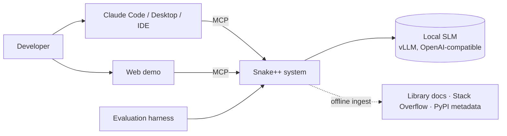
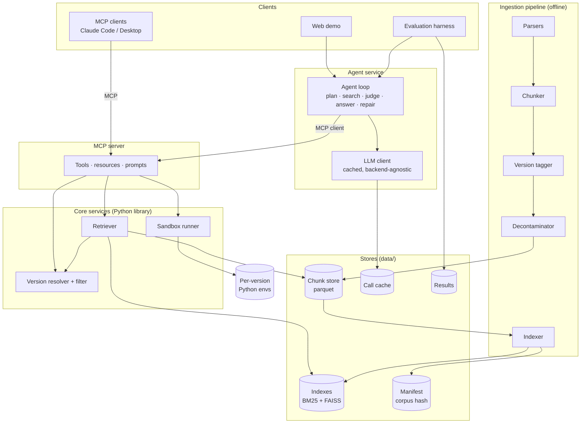
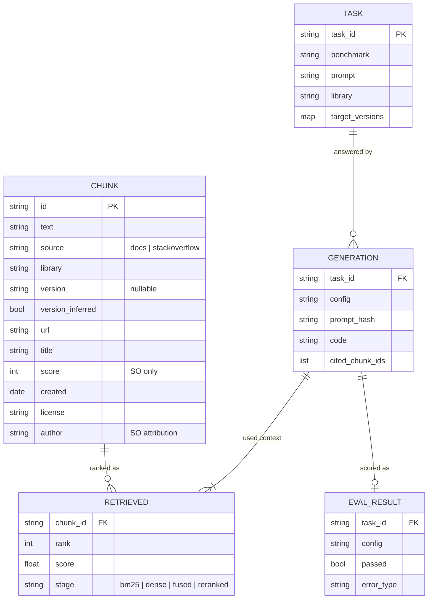
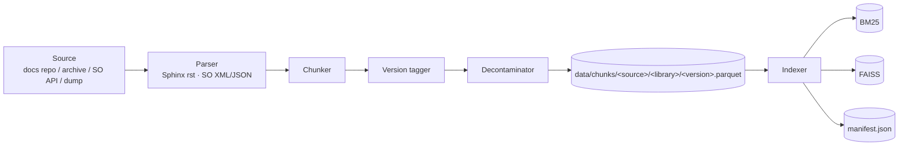
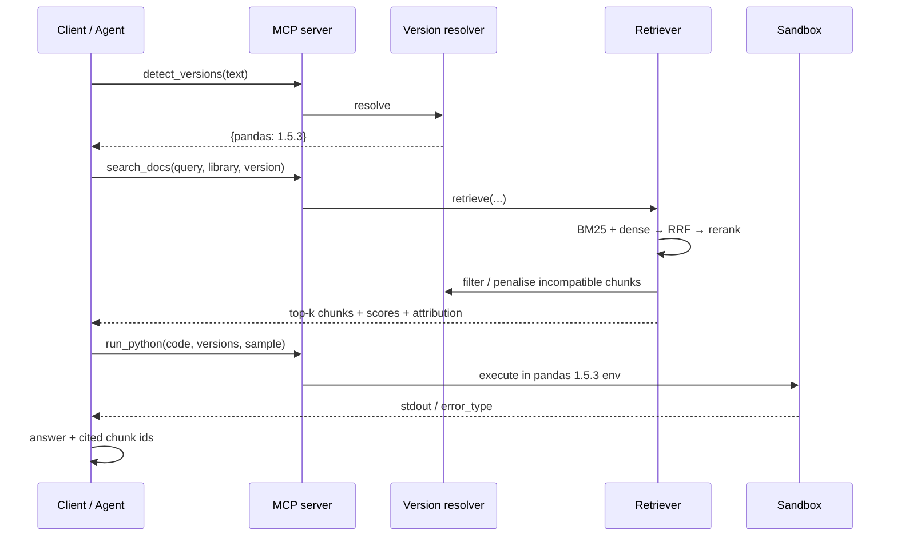
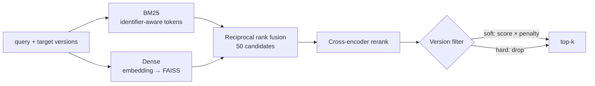
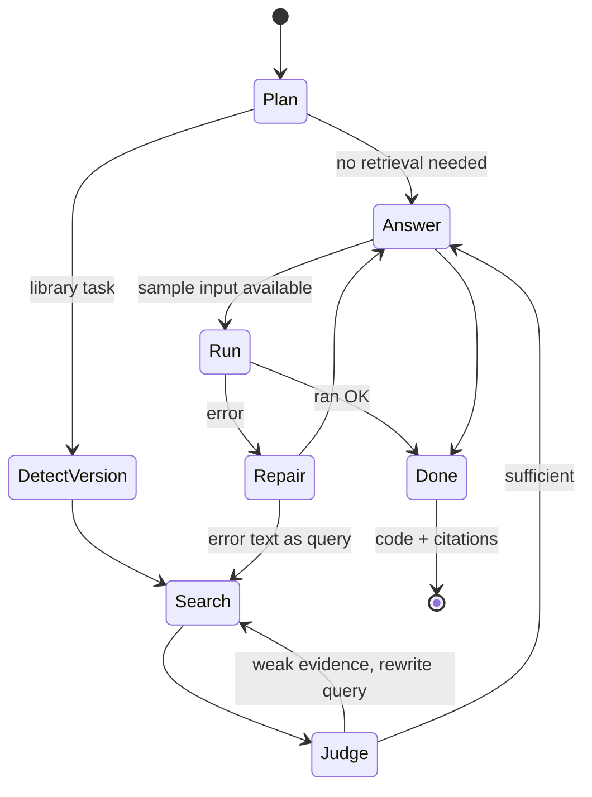

# Snake++ — Architecture

Version-aware retrieval-augmented coding assistant for Python. This document describes the system design and the reasoning behind it. The schedule, experiments and risks are in [PLAN.md](PLAN.md).

## 1. Goals and non-goals

**Goals**
- Answer Python questions with code that runs on the library versions the user has installed.
- Ground every answer in retrieved documentation or Stack Overflow text and cite the chunks used.
- Make retrieval and the agent usable from any MCP-aware client, not only our own UI.
- Make every component swappable and every result reproducible, so we can measure what each part contributes.

**Non-goals**
- No fine-tuning (goes stale at the next release, no citations).
- No multi-user service, auth or horizontal scaling. One machine, one corpus.
- No languages other than Python.

## 2. System context



Everything the user-facing clients need goes through one interface, the MCP server. The evaluation harness uses the same path, so what we measure is what ships.

## 3. Components



| Component | Responsibility | Does not do |
|---|---|---|
| **Ingestion pipeline** | Turn sources into versioned, licensed `Chunk` rows; build indexes | Serve queries |
| **Retriever** | Hybrid search, rerank, version filter; returns ranked chunk ids with scores | Generate text |
| **Version resolver** | Decide the target versions from explicit input, query text or requirements; judge chunk compatibility | Install packages |
| **Sandbox runner** | Execute code in a per-version environment with limits | Hold state between runs |
| **MCP server** | Expose retrieval, version and execution as tools with typed inputs and outputs | Contain business logic |
| **Agent loop** | Decide which tools to call and when to stop; assemble the answer with citations | Retrieve or execute itself |
| **LLM client** | One `complete()` call over vLLM / OpenAI-compatible / hosted backends; caches every call | Know about tasks |
| **Evaluation harness** | Run configs over benchmarks, score with tests, write results | Change pipeline behaviour |

**Dependency rule:** clients → agent → MCP server → core services → stores. Nothing points back up. The MCP server is a thin adapter; swapping FAISS for another store or vLLM for another backend touches one module each.

## 4. Data model

The shared types are pydantic models in `schemas.py`. They are the contract between all components.



Design points:
- `Chunk.id` is a hash of source URL + heading path + position, so re-ingesting the same source is idempotent.
- `version_inferred` separates versions we know (docs) from versions we guess from the post date (Stack Overflow), so the filter can treat them differently.
- Licence and author are on every chunk because Stack Overflow is CC BY-SA and each docs set has its own licence. Citations carry them through to the answer.
- A **manifest** (`manifest.json`) lists libraries × versions × chunk counts and a corpus hash. The hash is written into every result file.

## 5. Ingestion and indexing



| Stage | Design |
|---|---|
| **Docs parser** | Reads each library's source docs at a pinned version (repository tag or official archive). Keeps heading path, code blocks and URLs. |
| **Stack Overflow parser** | Streaming parse of the Stack Exchange API or the CC BY-SA dump; filters by tag, accepted answer, minimum score; drops known watermark rows. |
| **Chunker** | Docs: split by heading, code blocks never split, breadcrumb `library > version > page > heading` prefixed, ~512-token cap. Stack Overflow: one chunk per question + accepted answer. |
| **Version tagger** | Docs: explicit from the pin. Stack Overflow: inferred from the post date against PyPI release dates; flagged `version_inferred`. |
| **Decontaminator** | MinHash LSH (5-word shingles) plus embedding cosine against benchmark prompts. Writes a *clean* and a *leaky* variant so contamination can be measured instead of assumed. |
| **Indexer** | Embeds only chunk ids not seen before (cache key: chunk id + embedding model), rebuilds BM25 (seconds), appends to FAISS, rewrites the manifest. |

**Adding new data** is one command per source (`ingest docs --library X --version Y`, `ingest so --tags X --since D`) and needs no code change for a new library release. Ingestion is idempotent and resumable.

## 6. Query path



### 6.1 Retrieval internals



### 6.2 Agent loop



The agent is bounded: at most 3 searches, 2 executions and a fixed context budget. Hitting any cap forces `Answer`. It is itself an MCP *client*, so it has no private access to anything a Claude Desktop user does not also have.

## 7. MCP interface

| Tool | Input | Output |
|---|---|---|
| `search_docs` | `query`, `library`, `version?`, `top_k` | chunks with text, url, version, licence, scores |
| `search_stackoverflow` | `query`, `library`, `version?`, `top_k` | same, plus score, author, `version_inferred` |
| `detect_versions` | `text` (question, requirements, imports) | `{library: version}` |
| `list_indexed_versions` | `library?` | libraries × versions in the index |
| `get_chunk` | `chunk_id` | full chunk with attribution |
| `run_python` | `code`, `target_versions`, `sample?` | stdout, stderr tail, `error_type`, `timed_out` |

Also exposed: resource `snakepp://corpus/manifest` and prompt `version_aware_answer`.

- **Transports:** stdio for local clients, streamable HTTP for the demo and remote runs.
- **Schemas:** tool inputs and outputs reuse `Chunk` and `Retrieved`; nothing new in `schemas.py`.
- **Why MCP:** one tool surface for three consumers (evaluation, demo, any IDE), which also forces clean contracts between components.

## 8. Evaluation architecture

```mermaid
flowchart LR
  B[Benchmarks<br/>DS-1000 · HumanEval · MBPP · SnakeGold] --> T[Task loader<br/>reference solutions dropped]
  T --> P[Pipeline / Agent<br/>per config]
  P --> G[Generation + citations]
  G --> S[Sandbox<br/>hidden tests]
  S --> R[(Results<br/>dated, never overwritten)]
  R --> A[Analysis<br/>pass@1 · CI · McNemar]
  P --> RM[Retrieval metrics<br/>recall@k · MRR]
```

**Golden dataset (SnakeGold).** Public benchmarks give executable answers but no retrieval labels and few version traps, so we add three layers:

| Layer | Record | Expected answer | Used for |
|---|---|---|---|
| **G1 code** | question, target version, hidden pytest per version, gold doc chunk | test passes on version X and fails on version Y | pass@1 per version |
| **G2 retrieval** | query, gold chunk ids | chunk ids | recall@k, MRR, version-correct@k |
| **G3 agent** | task, expected decisions | needs retrieval y/n, target version, source | tool-decision accuracy |

Construction: G1 is seeded from release-note removals and deprecations, drafted with an LLM, then kept only if a human confirms the tests behave as stated in both pinned environments. G2 combines gold chunks from G1 with synthetic questions generated from sampled chunks (lexically trivial ones rejected) and a hand-verified subset. G3 labels follow written rules, not a model.

**Hygiene built into the design:** fixed dev/test splits, tuning on dev only, reference solutions never loaded, hidden tests never visible to the agent, result files append-only, corpus hash in every result.

## 9. Technology choices

| Concern | Choice | Why | Alternative rejected |
|---|---|---|---|
| Language / typing | Python 3.11, pydantic | Libraries we index and evaluate are Python; schemas as contracts | — |
| Chunking | Heading-aware; SO Q+A pairs | Docs are organised by function; splitting a signature loses the identifier a query names | Fixed windows (kept as an ablation) |
| Sparse retrieval | `rank_bm25`, identifier-aware tokenizer | Exact names and error strings; embeddings miss them | Plain tokenizer |
| Embedding | `BAAI/bge-small-en-v1.5` (33M, 384-d) | Small enough for CPU or a shared T4 | Larger embedders (one code embedder compared) |
| Vector store | FAISS, in-process flat index | ~60k × 384-d ≈ 90 MB, exact search, no server | Chroma, Qdrant, pgvector: server-side filtering and scale we do not need at this size; the store sits behind one class |
| Fusion | Reciprocal rank fusion | No score calibration between BM25 and cosine | Weighted sum |
| Reranker | `BAAI/bge-reranker-base` cross-encoder | Fixes right-area, wrong-chunk results | No rerank |
| Version handling | Resolve target, then soft penalty or hard drop on major-version mismatch | The project's central contribution | Ignore versions |
| Generator | `Qwen2.5-Coder-7B-Instruct` (AWQ), served by vLLM | Strong open code SLM, fits one T4 | Hosted APIs (no paid-API decision) |
| Agent controller | `Qwen3-8B` (AWQ), non-thinking mode | Native tool-calling format supported by vLLM; JSON-constrained fallback | Coder model for tool calls |
| Small-model comparison | `Qwen2.5-Coder-1.5B-Instruct` | Does retrieval help small models more? | — |
| Tool protocol | MCP (Python SDK) | One interface for all clients | Custom REST |
| Execution | Docker or per-version virtualenv, no network, timeout, memory cap | Needed to test the same code on two library versions | In-process `exec` |
| Judge | None; tests and rule-based citation checks | Correctness is executable | LLM-as-judge |

## 10. Cross-cutting concerns

- **Reproducibility:** every slow call (embedding, LLM, sandbox) is cached by a hash of inputs and config. Configs are YAML, never hard-coded. Results carry the corpus hash.
- **Security:** retrieved text (especially Stack Overflow) is untrusted. It is delimited as data in prompts and cannot trigger tools by itself. `run_python` has no network. Retrieval tools are read-only.
- **Licensing:** author and CC BY-SA licence stay on every Stack Overflow chunk and appear in citations; each docs set keeps its own licence.
- **Observability:** each generation stores its retrieved ids, stage scores, latency and tool calls, so a failure can be traced to retrieval, version choice, context use or generation.
- **Runtime footprint:** one process for the MCP server, one vLLM endpoint, one sandbox runner. Indexes load into memory (~100 MB).

## 11. Key decisions and open questions

| Decision | Status |
|---|---|
| In-process FAISS instead of a vector database | Decided |
| Agent is an MCP client over the same tools as external clients | Decided |
| Stack Overflow from the Stack Exchange API (the full dump needs ~220 GB of disk) | Decided; corpus is smaller than the RFC's 50–200k posts |
| Soft vs hard version filter | Open: settled by experiment |
| Agent controller model | Open: settled by a small tool-use pilot |
| Second (code) embedding model | Open: conditional on time |
