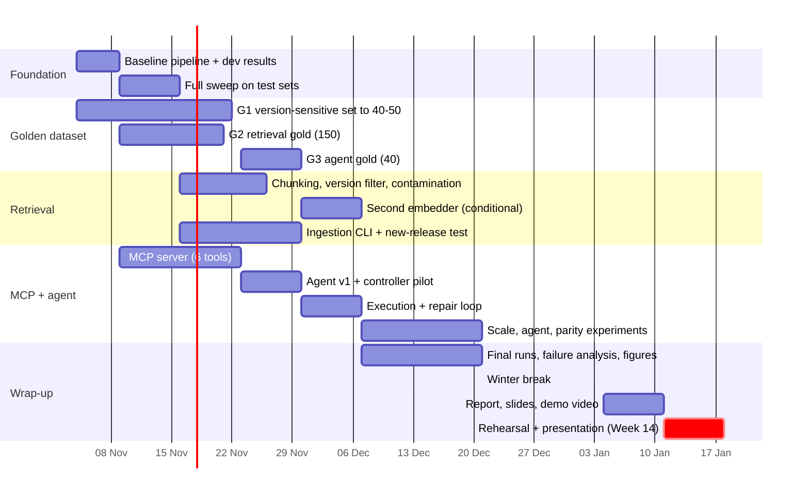

# Snake++ — Project Plan

The system design is in [ARCHITECTURE.md](ARCHITECTURE.md). This document covers what we build, in what order, how we evaluate it, and what can go wrong. Written Wed 4 Nov 2026 (Week 6).

## 1. Calendar

Source: UBB 2026-27 academic-year structure (teaching 28 Sep–20 Dec, winter break 21 Dec–3 Jan, teaching 4–17 Jan). Confirm against the FMI copy.

| Week | Dates | Note |
|---|---|---|
| 6 | 2–8 Nov | now |
| 7 | 9–15 Nov | |
| 8 | 16–22 Nov | |
| 9 | 23–29 Nov | |
| 10 | 30 Nov–6 Dec | 1 Dec off |
| 11 | 7–13 Dec | |
| 12 | 14–20 Dec | last teaching week before the break |
| — | 21 Dec–3 Jan | winter break |
| 13 | 4–10 Jan | 6–7 Jan off |
| **14** | **11–17 Jan** | **final presentation** |

## 2. Roles

**Lucas** corpus, ingestion, retrieval gold set · **Kevin** retrieval, MCP server, pipeline · **Enea** generation, agent loop, evaluation runs · **Roberto** version-sensitive set, agent gold set, analysis, demo, report.

## 3. Timeline

| Week | Dates | Work | Experiments | Gate |
|---|---|---|---|---|
| **6** | 2–8 Nov | Get the baseline pipeline running end to end on dev. Freeze corpus manifest and splits. Time the 7B generator on a Kaggle T4. Finish decontamination and SO attribution. | Dev runs of all six configs | **M3:** first results table (dev) |
| **7** | 9–15 Nov | Full test sweep. Build retrieval gold set. Start MCP server. | E0, E1, E2 | Table 1 with confidence intervals |
| **8** | 16–22 Nov | Tune on dev only. Add Hugging Face items to the version set. Finish MCP server and connect it to Claude Code. Start ingestion CLI. | E3, E5, E6 | **M4:** fixed-pipeline numbers frozen; golden sets G1, G2 frozen; MCP smoke test passes |
| **9** | 23–29 Nov | Agent v1 loop. Controller pilot. Build agent gold set. | Controller choice; E8 pilot on 20 tasks | Agent answers one task end to end via MCP |
| **10** | 30 Nov–6 Dec | Execution and repair loop. Finish ingestion CLI and ingest an unseen release. | E10, E4 (optional) | **M5:** agent + MCP work end to end |
| **11** | 7–13 Dec | Main agent runs. Model-scale arm. Parity test. Demo talks to MCP. | E7, E8, E9 | All experiments run once |
| **12** | 14–20 Dec | Final runs on the clean index. Citation accuracy. 50-case failure analysis. Final figures. Freeze code and configs. | final tables | **M6:** results frozen, `v0.9` tagged |
| **Break** | 21 Dec–3 Jan | No new features. Unattended reruns of failed jobs; one writing block per person. | — | — |
| **13** | 4–10 Jan | Report, slides, 2-minute demo video, reproduction check on a clean machine, internal dry run. | — | **M7:** report and slides done; `v1.0` tagged |
| **14** | 11–17 Jan | Two rehearsals, final presentation. | — | **Presentation** |

**Assumed checkpoints** (confirm with the course): a progress check around Week 9–10 using the M4 numbers, and the presentation in Week 14. The written report may be due after 18 Jan; 10 Jan is the internal deadline either way.

**Scope cuts, in order, if late:** second embedder → hosted-model ceiling run → MBPP → Hugging Face items → third model in E7 → SciPy → smaller Stack Overflow subset.
**Never cut:** no-retrieval baseline, hybrid + rerank, version filter experiment, decontamination, a working MCP tool set, agent vs fixed pipeline on the version-sensitive set.

## 4. Experiments

Hypotheses are stated before the runs. Differences are reported with bootstrap 95% confidence intervals; paired comparisons against the baseline use McNemar's test. Tuning uses dev splits only.

| # | Experiment | Compare | Data | Hypothesis |
|---|---|---|---|---|
| E0 | Baseline | no retrieval | all | the model alone is weak on version traps |
| E1 | Source ablation | none / docs / SO / both | DS-1000, HumanEval, MBPP, G1 | docs help more than SO on API-heavy tasks |
| E2 | Retrieval components | dense / hybrid / hybrid + rerank | G2 + pass@1 | BM25 helps on identifiers; rerank helps top-1 |
| E3 | Chunking | heading-aware vs fixed window | G2 + dev pass@1 | heading-aware wins recall@3 |
| E4 | Embedding (conditional) | bge-small vs one code embedder | G2 | small gain; cut first if late |
| E5 | **Version filter** | off / soft / hard (penalty 0.1, 0.3, 0.5) | G1, DS-1000 pandas | soft ≥ hard > off; hard fails when no compatible chunk exists |
| E6 | Contamination | clean vs leaky Stack Overflow index | DS-1000 | leaky index inflates pass@1 |
| E7 | Model scale | 1.5B / 7B (/ Qwen3-8B) × {no retrieval, full} | G1, DS-1000 dev | retrieval helps the smaller model more |
| E8 | **Agent vs fixed** | fixed pipeline / agent / agent + execution (+ rule-based router) | G1, DS-1000 subset, G3 | agent skips retrieval on easy tasks and repairs version errors, at 3–5× the tokens |
| E9 | MCP parity | in-process agent vs agent through MCP | G1 | same pass@1; report per-tool latency |
| E10 | Ingestion | add an unseen release (pandas 3.0), no code change | 5 new questions | works; report ingest time |

Failure analysis: 50 failed cases from E5 and E8, tagged retrieval miss / wrong version / ignored context / generation error / sandbox issue.

**Compute.** Free Kaggle/Colab T4 only (Kaggle: 2 × T4, about 30 h/week, 12 h sessions). About 1,300 tasks × 9 configs ≈ 12k generations for the fixed pipeline. The agent costs 3–5× per task, so agent runs use the version-sensitive set plus a stratified 300-problem DS-1000 subset. All calls are cached and sweeps resume, so a lost session costs nothing already finished. Per-problem timing on the T4 is measured in Week 6 and the estimate above is revised then.

## 5. Risks

| Risk | Mitigation |
|---|---|
| Kaggle quota or session loss | Cache and resumable sweeps; 4-bit quantised 7B on one T4; agent runs on subsets; reruns queued over the break |
| Small model is unreliable at tool calling | JSON-constrained action step; rule-based router as a control; report honestly if the agent does not win |
| Stack Overflow corpus is smaller than the RFC (API instead of the 220 GB-disk dump) | State it in the report; scale toward ~30k posts with an API key; main claims also hold on docs |
| Wrong versions inferred for Stack Overflow posts | Hand-label 100 posts and report accuracy; flag inferred versions so the filter can be softer on them |
| Benchmark contamination | Clean vs leaky index (E6); never tune on test; our own set is unseen |
| Agent leakage | `run_python` only sees the sample input in the prompt, never hidden tests |
| Prompt injection from Stack Overflow text | Delimited context, "data, not instructions", sandbox without network |
| Licensing | Author and CC BY-SA on every Stack Overflow chunk and in demo citations |
| Small golden sets (about 45 items) | Report intervals and paired tests; avoid claims about small differences |

## 6. Golden dataset: build steps

1. **G1:** collect removals and deprecations from release notes → draft question and two tests → a human runs both tests in both pinned environments → keep only items that behave as expected → record gold doc chunks → second reviewer on 20%.
2. **G2:** gold chunks from G1 → sample chunks and generate questions → reject questions with BM25 overlap above 0.6 → hand-verify 50 → report agreement (Cohen's κ) on the double-labelled 20%.
3. **G3:** write decision labels from the rules in the architecture document.
4. Freeze G1 and G2 by 22 Nov and G3 by 29 Nov, before any tuning that touches them.
